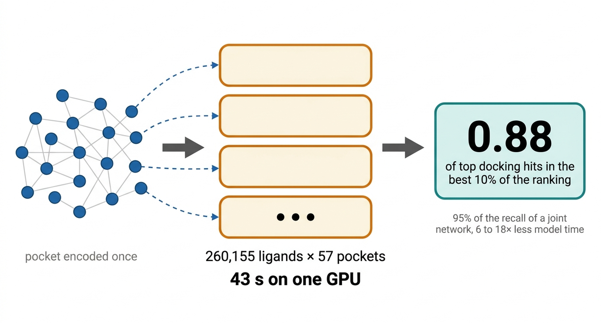
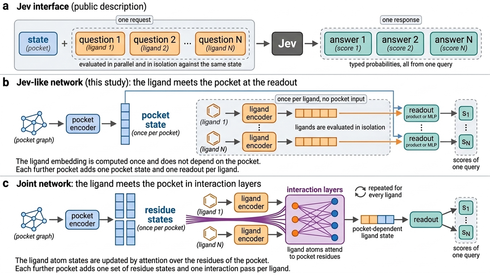
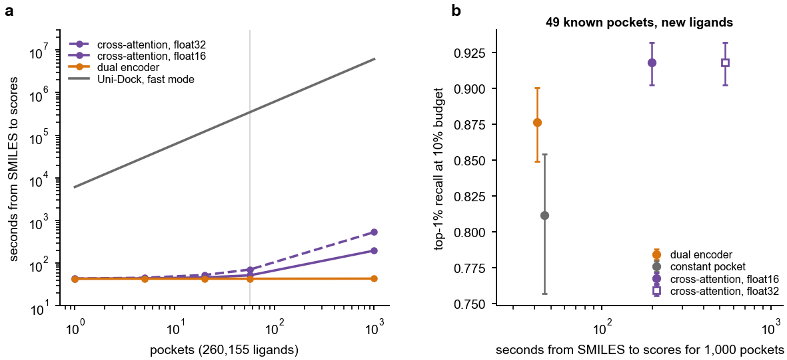

# Jev-Like Shared-State Networks for Fast Structure-Based Screening

Code and data for the manuscript by Hyunseung Kong, Interdisciplinary Program in Bioinformatics, Seoul National University.



## Summary

Docking limits structure-based virtual screening: the fastest search mode of Uni-Dock needs 4.0 GPU-days for the 260,155 ligands of DOCKSTRING against 57 pockets. A Jev-like network encodes each pocket once into a shared state and embeds each ligand independently of the pocket, so that a cheap readout scores every pair and the screen of a library against many pockets reduces to a matrix product. On 49 known pockets of DOCKSTRING, a dual encoder of this organization recovers 0.88 of the top-1% docking hits of new ligands in the best 10% of the ranking, which is 95% of the 0.92 of a cross-attention network with the same encoders, against 0.81 for a network that sees only the ligand. On one RTX 4090 the dual encoder ranks the ligands against 57 pockets from SMILES in 43.3 s and against 1,000 pockets in 43.5 s, and the cross-attention network needs 4.5 to 12 times longer for 1,000 pockets.

## Figures



**Figure 1.** The Jev interface (a), the Jev-like network (b) and the joint cross-attention network (c).



**Figure 2.** Time from SMILES to scores against the number of pockets (a), and recall against the time for 1,000 pockets (b).

## Contents

- `src/pocketgate/`: library (models, features, data preparation, metrics).
- `scripts/`: training, evaluation, timing and docking benchmark.
- `configs/g2_config.json`: the 40,000 training and the 10,000 evaluation ligands.
- `data/splits/`: target and ligand splits and the cross-validation folds. `data/processed/`: pocket graphs.
- `runs/`: run records and per-pocket results of the trained networks.
- `eval/`: summaries and timing records of the paper.
- `figures/`: the figures of the paper.

Checkpoints and predictions (`runs/**/ckpt_*.pt`, `runs/v4/pred_*.parquet`) are in `checkpoints_and_predictions.zip` under Releases (v1.0). Unzip it in the repository root.

## Reproduce

Python 3.11 or newer; `pip install -r requirements.txt` (and PyTorch).

**Figure 2 from the shipped outputs (CPU).**

```bash
python scripts/plot_cost.py
```

**Evaluation summaries.** `--summary-only` rebuilds them from the per-pocket results in `runs/v5`; without it the scripts score the networks (GPU recommended, needs the data below). `v4_cv_analyze.py` reads the predictions in `runs/v4`, which are in the release archive.

```bash
python scripts/v5_known_pockets_eval.py --summary-only
python scripts/v5_known_cv_eval.py --summary-only
python scripts/v4_cv_analyze.py
```

**Data.** Download `dockstring-dataset.tsv` and `cluster_split.tsv` (figshare 16511577) to `data/raw/`, and the receptors and boxes of the 58 targets (`resources/targets` of https://github.com/dockstring/dockstring, commit b5398322) to `data/raw/targets/`. Then:

```bash
python src/pocketgate/data/standardize.py
python src/pocketgate/data/split.py
python scripts/g2_prepare.py
python scripts/g2_featurize.py
python scripts/v1b_featurize.py
python scripts/v4_make_folds.py
```

**Training.** Training on GPUs is not bit-reproducible; the numbers of the paper come from the shipped checkpoints.

```bash
python scripts/v1b_train.py
python scripts/v2_train.py "C0:22,C0:33,C0c:11,C0c:22,C0c:33"
python scripts/v3_train_joint.py xattn:11,xattn:22,xattn:33,pooled:11,pooled:22,pooled:33
jobs=$(for f in 0 1 2 3 4; do for c in dual dual_const pooled pooled_const xattn xattn_const; do printf "$f:$c:R0:11,"; done; for c in dual xattn; do printf "$f:$c:R1:11,"; done; done)
python scripts/v4_cv_train.py "${jobs%,}"
```

**Timing and Uni-Dock benchmark.**

```bash
python scripts/make_wt_pockets.py
python scripts/v4_fair_timing.py --out eval/v4_fair_timing.json --xattn-fp32-1000
```

The Uni-Dock environment is set up by `scripts/pod_setup.sh`, the ligand lists by `scripts/make_bench_ligands.py`, and the benchmark commands are in the docstring of `scripts/dock_rate_bench.py`.

## Data and license

DOCKSTRING receptors, ligands and scores come from https://github.com/dockstring/dockstring (Apache License 2.0). This repository is released under the Apache License 2.0.

## Contact

Hyunseung Kong, hskong@snu.ac.kr
